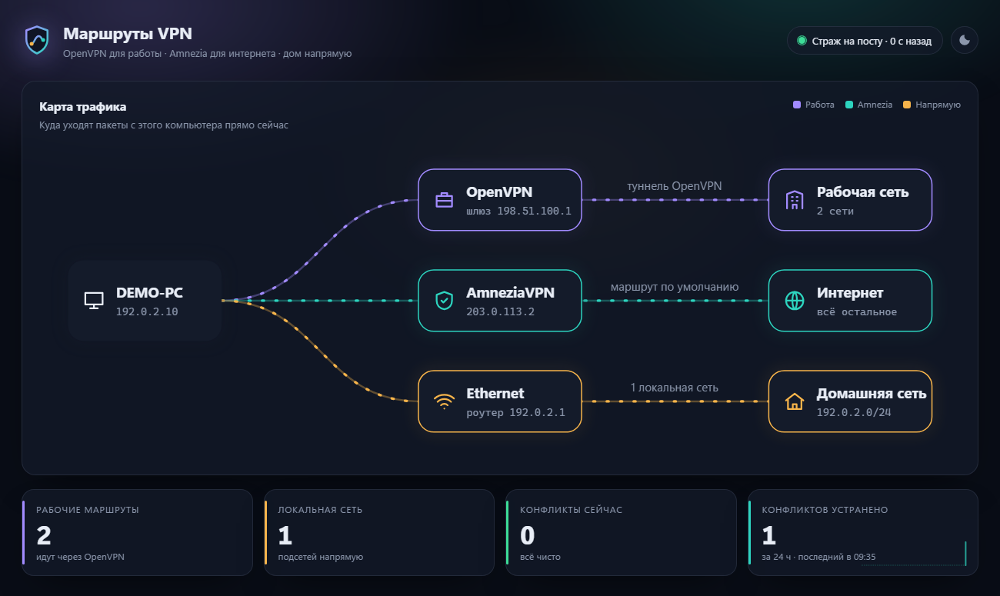
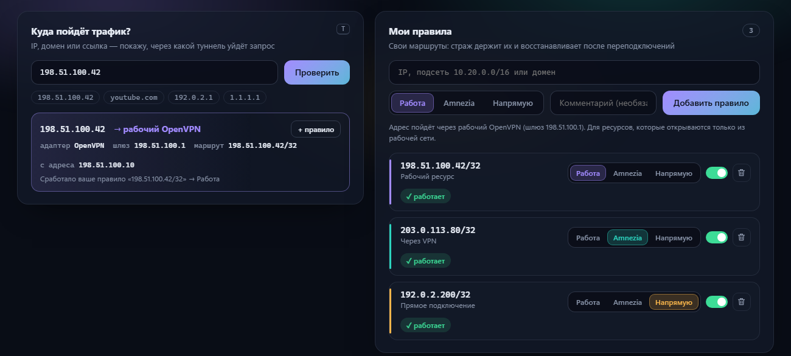
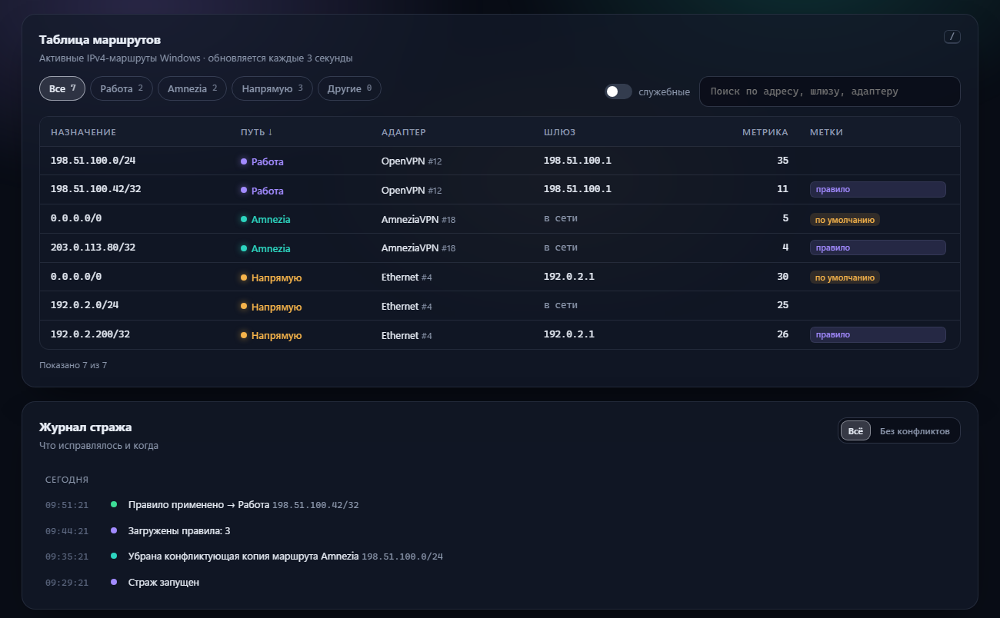

# Маршруты VPN для Windows

RouteGuard помогает использовать рабочий OpenVPN Connect и AmneziaVPN одновременно. Он следит за конфликтующими IPv4-маршрутами, сохраняет доступ к рабочим и локальным сетям и показывает, через какой интерфейс Windows отправит трафик. В панели можно направить отдельный IP-адрес, подсеть или домен через OpenVPN, AmneziaVPN либо напрямую.

## Установка на Windows 10 или 11

Понадобятся учётная запись Windows с правами администратора и действующие профили для обоих VPN. Установщик панели использует встроенный Windows PowerShell.

### 1. Установите VPN-клиенты и импортируйте профили

1. Установите **OpenVPN Connect** для Windows. В клиенте откройте **My Profiles → + → Upload File**, выберите рабочий файл `.ovpn` и подтвердите импорт. Проверьте, что профиль подключается. [Установка OpenVPN Connect](https://openvpn.net/connect-docs/installation-guide-windows/) · [Импорт профиля OpenVPN](https://openvpn.net/connect-docs/import-profile/)
2. Установите **AmneziaVPN** для Windows. Если у вас файл `.conf` или `.json`, нажмите **+ → Файл с настройками подключения**, выберите файл и нажмите **Продолжить → Подключиться**. Если получили ключ `vpn://…`, выберите ввод ключа и вставьте его. [Загрузка AmneziaVPN](https://amnezia.org/downloads) · [Импорт настроек AmneziaVPN](https://docs.amnezia.org/ru/documentation/instructions/connect-via-config/)

### 2. Скачайте и распакуйте «Маршруты VPN»

1. На странице репозитория нажмите **Code → Download ZIP**.
2. В Проводнике нажмите правой кнопкой по скачанному ZIP и выберите **Извлечь всё…**. Откройте распакованную папку и убедитесь, что рядом с `Install.cmd` есть `Setup.ps1` и папка `app`.
3. Если переносите правила, положите `VPN-Routes-settings.json` в ту же папку **до запуска `Install.cmd`**. Как получить файл, описано в разделе [«Перенос на другой ПК»](#перенос-на-другой-пк).

При чистой установке список пользовательских правил пуст. Если OpenVPN использует один активный адаптер и его конкретные IPv4-маршруты используют один шлюз, RouteGuard определит этот шлюз автоматически. При необходимости задайте параметры в `app/RouteGuard.json` до установки.

| Параметр | Что указать |
| --- | --- |
| `AmneziaAlias` | Имя сетевого адаптера AmneziaVPN. |
| `WorkAdapterPattern` | Шаблон описания сетевого адаптера OpenVPN. |
| `WorkGateway` | IPv4-адрес шлюза OpenVPN. Оставьте пустым для автоопределения. |
| `WorkEndpointIPv4` | Список IPv4-адресов серверов OpenVPN, которые должны быть доступны напрямую. |

Если рядом с `Install.cmd` есть файл переноса, установщик берёт параметры из него.

### 3. Запустите установщик

1. В распакованной папке дважды щёлкните `Install.cmd`. Подтвердите запрос контроля учётных записей Windows кнопкой **Да**.
2. Дождитесь сообщения «Установка завершена». Установщик разместит файлы в `%ProgramData%\CodexVpnRouteGuard`, создаст ярлыки на рабочем столе и в меню «Пуск» и зарегистрирует две задачи автозапуска в Планировщике заданий — `VPN Routes - Guard` и `VPN Routes - Panel`.
3. Откройте **Маршруты VPN** через созданный ярлык. Он передаст ключ браузеру и откроет `http://vpn.localhost/`. Если порт 80 занят, ярлык использует `http://127.0.0.1:47123/`.

### 4. Проверьте результат

1. Подключите рабочий профиль в OpenVPN Connect и профиль в AmneziaVPN. Обновите панель и проверьте, что она видит оба подключения.
2. В блоке **«Куда пойдёт трафик?»** введите известный рабочий IP-адрес или домен и нажмите **Проверить**. Для адреса, который должен идти через рабочий туннель, проверьте, что панель показывает путь **Работа**.
3. Если переносили правила, откройте **«Мои правила»** и проверьте, что список появился. Для правил со статусом **«ожидает»** посмотрите причину под правилом.

### Если установка или первый запуск не удались

- **Панель просит ключ.** Откройте её через ярлык **Маршруты VPN** в нужном браузере. При открытии адреса вручную ключ не передаётся.
- **Установщик сообщает, что каталог уже существует.** Если на ПК уже стоит эта панель, сначала экспортируйте правила и выполните [удаление](#удаление), затем повторите установку с файлом переноса. Для отдельной старой версии RouteGuard без панели используйте её процедуру удаления или миграции.
- **Установщик сообщает, что панель не запустилась на порту 47123.** Убедитесь, что этот порт свободен, и повторите установку. Он нужен и при доступе через `vpn.localhost`.
- **Панель открывается, но не видит один из VPN.** Убедитесь, что профиль подключён в соответствующем клиенте. Для AmneziaVPN проверьте имя сетевого адаптера, для OpenVPN — описание адаптера и шлюз рабочего туннеля.

## Как пользоваться

На скриншотах используются демонстрационные IP-адреса и маршруты. Для проверки на своём ПК подставьте адрес нужного ресурса.

### Посмотрите, какие подключения активны

Откройте **«Маршруты VPN»** через ярлык и посмотрите на **«Карту трафика»**. Фиолетовая линия соответствует рабочему OpenVPN, бирюзовая — AmneziaVPN, жёлтая — прямому подключению через Wi-Fi или Ethernet. Вверху отображается состояние RouteGuard. Счётчики под картой показывают рабочие и локальные маршруты, текущие конфликты и исправления за последние сутки.

### Проверьте адрес и добавьте правило

1. В блоке **«Куда пойдёт трафик?»** введите IPv4-адрес, домен или URL и нажмите **Проверить**. Панель покажет выбранный Windows путь, сетевой адаптер, шлюз и совпавший маршрут. У домена с несколькими IPv4-адресами результат может отличаться для каждого адреса.
2. Чтобы задать свой путь, нажмите **+ правило** в результате проверки или введите назначение в **«Мои правила»**. Поддерживаются отдельный IPv4-адрес, подсеть в формате CIDR и домен. Например, `198.51.100.42` задаёт один адрес, а `198.51.100.0/24` — целую подсеть.
3. Выберите **Работа** для рабочего OpenVPN, **Amnezia** для AmneziaVPN или **Напрямую** для выхода через физическую сеть. При желании добавьте комментарий и нажмите **Добавить правило**.
4. Дождитесь статуса **«работает»** и повторите проверку адреса. Статус **«ожидает»** сопровождается причиной, например отключённым туннелем или недоступным DNS. Путь можно изменить в карточке правила. Переключатель временно выключает правило, а кнопка с корзиной удаляет его после подтверждения.

### Найдите маршрут и посмотрите, что изменилось

- В **«Таблице маршрутов»** отфильтруйте строки по пути или найдите нужную подсеть, шлюз либо адаптер через поиск. Метка **«правило»** обозначает маршрут, которым управляет пользовательское правило. Метка **«страж»** обозначает маршрут, созданный автоматически RouteGuard.
- В **«Журнале стража»** видны запуски, применение правил, исправления конфликтов и ошибки. Переключатель **«Без конфликтов»** скрывает записи об устранённых конфликтах, оставляя остальные события.

## Перенос на другой ПК

1. На исходном ПК с установленной панелью запустите `Export-settings.cmd`.
2. Скопируйте полученный `VPN-Routes-settings.json` рядом с `Install.cmd` на новом ПК **до установки**.
3. Запустите установку. Она прочитает настройки и правила из файла и создаст новый ключ панели. VPN-профили импортируются отдельно в свои клиенты.

Файл экспорта может содержать рабочие адреса и домены. Передавайте его приватно.

## Удаление

Из той же учётной записи запустите `Uninstall.cmd` и подтвердите удаление буквой `Y`. Затем переподключите оба VPN, чтобы их клиенты заново создали свои маршруты. Чтобы сохранить правила, сначала выполните экспорт.
